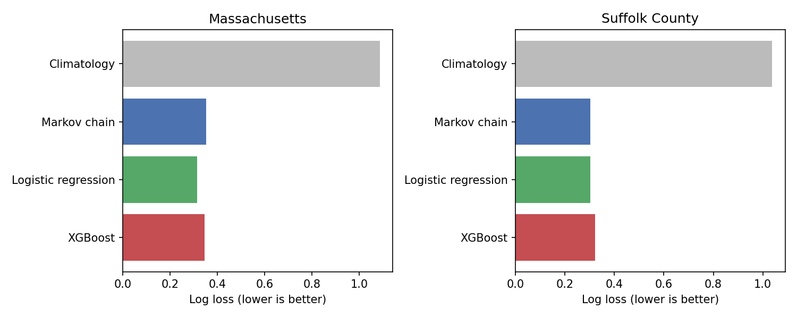
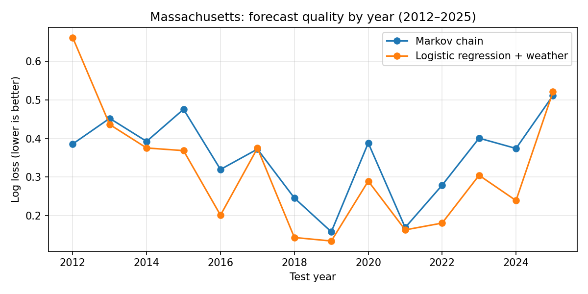
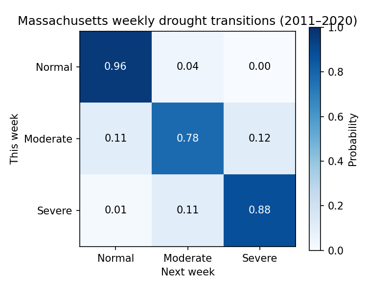

# Massachusetts Drought Forecasting: Markov Chain vs. Weather-Based ML

Forecasting next week's drought state for **Massachusetts** and **Suffolk County** from U.S. Drought Monitor data. The project starts with a 3-state Markov chain, then tests whether adding weather data (rainfall, temperature, season) and machine learning improves the forecast, with every model checked against simple baselines.

## Key findings

- **Weather helps at the state level.** For Massachusetts, logistic regression with weather features gave the best probability forecasts: log loss **0.313 vs. 0.351** for the Markov chain (about 11% better), and better in about 10 of 14 test years.
- **It doesn't help in Suffolk County.** There the Markov chain was as good or better (log loss 0.302 vs. 0.303).
- **Drought changes are hard to call a week ahead.** The state changed in only 73 of 731 Massachusetts test weeks. Logistic regression caught 8 of them (28 false alarms); XGBoost caught 13 but with 42 false alarms and worse probabilities.
- **Simple beat complex.** With about 1,300 weekly rows, XGBoost overfit compared with logistic regression.
- **The model learned sensible patterns.** More rain over the last 4–12 weeks pushes the forecast toward "Normal"; hotter weeks push away from it.

## Results: rolling evaluation, 2012–2025

Each test year is forecast by models trained only on the weeks *before* that year (731 weekly forecasts per region).

**Massachusetts**

| Model | Accuracy | Macro-F1 | Log loss ↓ | Brier ↓ | Changes caught | False alarms |
|---|---|---|---|---|---|---|
| Persistence (no change) | 0.900 | 0.877 | n/a | n/a | 0/73 | 0 |
| Climatology (base rates) | 0.557 | 0.238 | 1.086 | 0.643 | 21/73 | 272 |
| Markov chain | 0.900 | 0.877 | 0.351 | **0.179** | 0/73 | 0 |
| **Logistic regression + weather** | 0.873 | 0.840 | **0.313** | 0.183 | 8/73 | 28 |
| XGBoost + weather | 0.860 | 0.826 | 0.346 | 0.198 | 13/73 | 42 |

**Suffolk County**

| Model | Accuracy | Macro-F1 | Log loss ↓ | Brier ↓ | Changes caught | False alarms |
|---|---|---|---|---|---|---|
| Persistence (no change) | 0.921 | 0.900 | n/a | n/a | 0/58 | 0 |
| Climatology (base rates) | 0.596 | 0.249 | 1.038 | 0.610 | 18/58 | 255 |
| **Markov chain** | 0.921 | 0.900 | **0.302** | **0.147** | 0/58 | 0 |
| Logistic regression + weather | 0.895 | 0.867 | 0.303 | 0.168 | 2/58 | 21 |
| XGBoost + weather | 0.891 | 0.857 | 0.321 | 0.175 | 5/58 | 27 |





### Why accuracy isn't the main metric

Drought rarely changes week to week, so "predict no change" already scores about 90% accuracy. The Markov chain's most likely state is always "stay the same", which is why its accuracy matches persistence. The useful comparison is the **probability** forecast (log loss and Brier score) and how many real changes a model catches without too many false alarms.

## Part 1: the original Markov chain (single test year, 2021)

The first version trained a Markov chain on 2011–2020 and tested on 2021 (51 forecasts). It scored 0.926 macro-F1 for Massachusetts, but drought changed only twice that year, and the result matched the persistence baseline exactly. Compared with climatology, it cut log loss from 0.689 to 0.177. That small test year is why Part 2 moved to a rolling evaluation over 14 years.



## Data

- **Drought:** [U.S. Drought Monitor](https://droughtmonitor.unl.edu/DmData/TimeSeries.aspx) weekly DSCI (Drought Severity and Coverage Index, 0–500), from the Drought Monitor data API (`StateStatistics/GetDSCI`, `CountyStatistics/GetDSCI`, Suffolk FIPS 25025), January 2000 to April 2026
- **Weather:** NOAA daily summaries for Boston Logan International Airport (station USW00014739): rainfall, daily high and low temperature, totalled or averaged into the same Tuesday-ending weeks as the drought maps
- **Limitation:** one Boston station is a close match for Suffolk County but only a stand-in for the whole state

### Drought states (this project's own grouping of DSCI)

| State | DSCI |
|---|---|
| 0 · Normal | below 24 |
| 1 · Moderate | 24 – 115 |
| 2 · Severe | 116 and above |

## Features

| Feature | Meaning |
|---|---|
| `State`, `DSCI` | Current drought state and index |
| `dsci_change_1w`, `dsci_change_4w` | How fast the drought index is changing |
| `precip_1w`, `precip_4w`, `precip_12w` | Rainfall over the last 1, 4 and 12 weeks |
| `precip_4w_anomaly` | Last 4 weeks' rain minus the 2000–2010 average for that time of year (2000–2010 is never used as test data) |
| `tmax_4w` | Average daily high over the last 4 weeks |
| `season_sin`, `season_cos` | Time of year, encoded so late December and early January are close |

## Models

- **Persistence:** next week = this week
- **Climatology:** training-period frequency of each state
- **Markov chain:** 3×3 transition matrix with additive smoothing (α = 0.5), `P_ij = (N_ij + α) / (Σ_j N_ij + 3α)`
- **Logistic regression:** standardized features, scikit-learn
- **XGBoost:** 200 shallow trees (depth 3), learning rate 0.05

## How to run

Open `Drought.ipynb` in Jupyter or [Google Colab](https://colab.research.google.com/) and run all cells. The notebook downloads the drought data itself. It downloads the Boston weather data from NOAA and saves it as `boston_weather_daily.csv`; if that file is already present, it is loaded instead, so NOAA is only needed once.

```bash
git clone https://github.com/satwikachowdary/massachusetts-drought-forecasting.git
cd massachusetts-drought-forecasting
pip install -r requirements.txt
jupyter notebook Drought.ipynb
```

## Next steps

- Use several weather stations, or a statewide rainfall series, for the Massachusetts model
- Forecast 2–4 weeks ahead, where weather should matter more
- Tune the decision threshold to trade caught changes against false alarms
- Move the code into Python modules with tests

## Tech stack

Python · Pandas · NumPy · scikit-learn · XGBoost · Matplotlib · Jupyter

## Author

**Satwika Poluru** · [LinkedIn](https://linkedin.com/in/satwika-poluru) · [GitHub](https://github.com/satwikachowdary)
